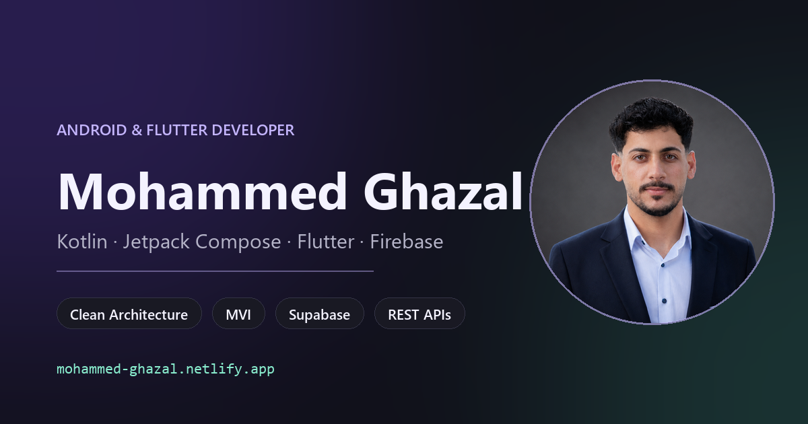

# Mohammed Ghazal — Android & Flutter Developer

Portfolio of Mohammed Amen Ghazal, an Android and Flutter developer based in Gaza, Palestine.
One static page: bilingual English/Arabic with RTL, light and dark themes, and 106 real app screens.

**Live site:** https://mohammed-ghazal.netlify.app



## Highlights

- Bilingual English/Arabic with a full right-to-left layout (Tajawal for Arabic typography)
- Light and dark themes, system preference as the default, remembered in local storage
- Five projects with category filtering, plus per-gallery dark/light theme filters
- Keyboard-accessible image viewer and certificate dialog (Escape, focus restoration, live counters)
- Scroll progress bar, staggered scroll reveals, and count-up hero stats via IntersectionObserver
- Reduced-motion support, plus working navigation and image links when JavaScript is disabled
- WebP derivatives with `<picture>` and responsive `srcset` for screenshots, certificates, logos, and the portrait

## Projects

| Project | Category | Stack | Screens | Source |
| --- | --- | --- | --- | --- |
| devZ | Developer community | Kotlin, Compose, Clean Architecture, MVI | 56 | [repo](https://github.com/mohammed-amin20/devz) |
| Memo | Offline notes | Kotlin, Compose, Room, Hilt | 30 | [repo](https://github.com/mohammed-amin20/Memo) |
| Dictionary | Language & learning | Kotlin, Compose, MVI, Retrofit | 9 | [repo](https://github.com/mohammed-amin20/Dictionary) |
| Rick & Morty | Entertainment | Kotlin, Compose, Clean Architecture, MVI, Room | 11 | [repo](https://github.com/mohammed-amin20/Rick-And-Morty) |
| Company accounting app | Business | Flutter, Supabase | — | in development |

Also included: three Avatar training certificates (90 training hours) with published credential IDs.

## Tech stack

Kotlin · Jetpack Compose · Flutter & Dart · Clean Architecture · MVI · Room · Hilt · Retrofit · Firebase · Supabase · REST APIs

## Repository structure

```
index.html            page content and generated work/certificate sections
styles.css            single stylesheet: tokens, base, layers, polish
experience.js         translations, themes, scroll progress, reveals, counters
portfolio.js          navigation, filters, screenshot viewer
certificates.js       certificate dialog
assets/               logos, portrait + WebP sizes, CV, screenshots
                      (devz/, memo/, dictionary/, rick-and-morty/)
certificates/         original bilingual certificate artwork
tools/                build_showcase.py, build_certificates.py, optimize_assets.py
robots.txt sitemap.xml assets/og-image.png
```

Generated regions are written by `tools/build_showcase.py` and `tools/build_certificates.py` — edit those scripts instead of `index.html` when changing project or certificate content.

## Local development

```bash
python -m http.server 8000     # serve at http://localhost:8000
python tools/build_showcase.py # regenerate the work section
python tools/build_certificates.py
python tools/optimize_assets.py
```

No dependencies or build step are required; the site is served as static files. Deploy steps are in [README.txt](README.txt).

## Contact

[GitHub](https://github.com/mohammed-amin20) · [Upwork](https://www.upwork.com/freelancers/~012fda40e3e6df2a37) · [Mostaql](https://mostaql.com/u/Mohammed_AmenGH) · [Khamsat](https://khamsat.com/user/mohammed_amengh) · [Freelancer](https://www.freelancer.com/u/MohammedAmenGH) · mohammedamenghzal03@gmail.com
